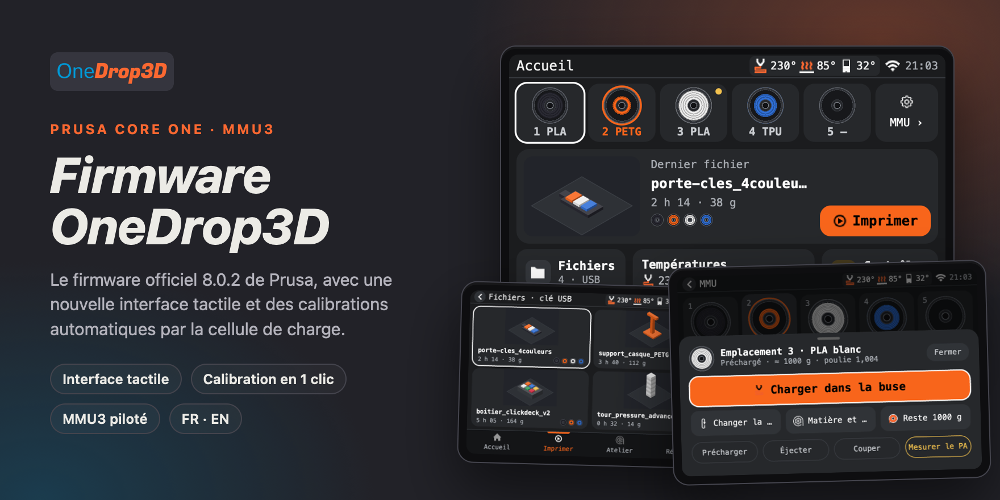
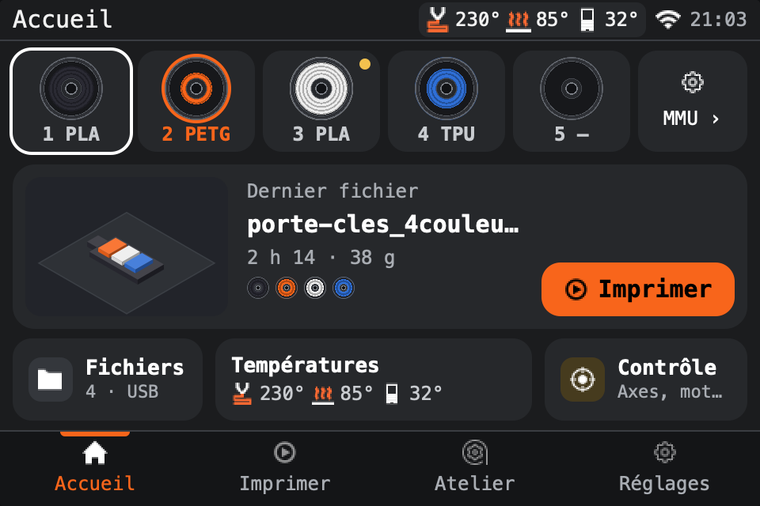
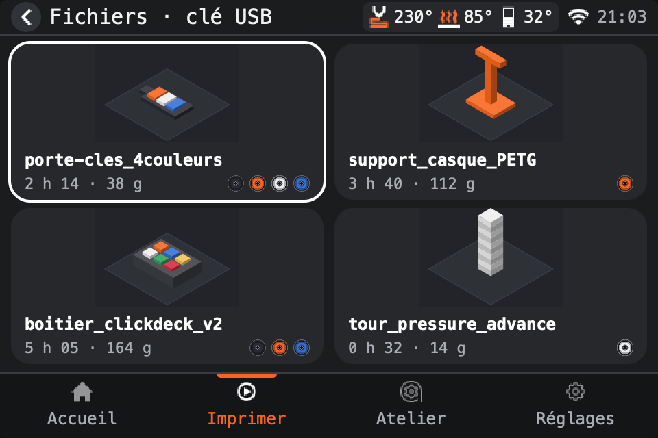
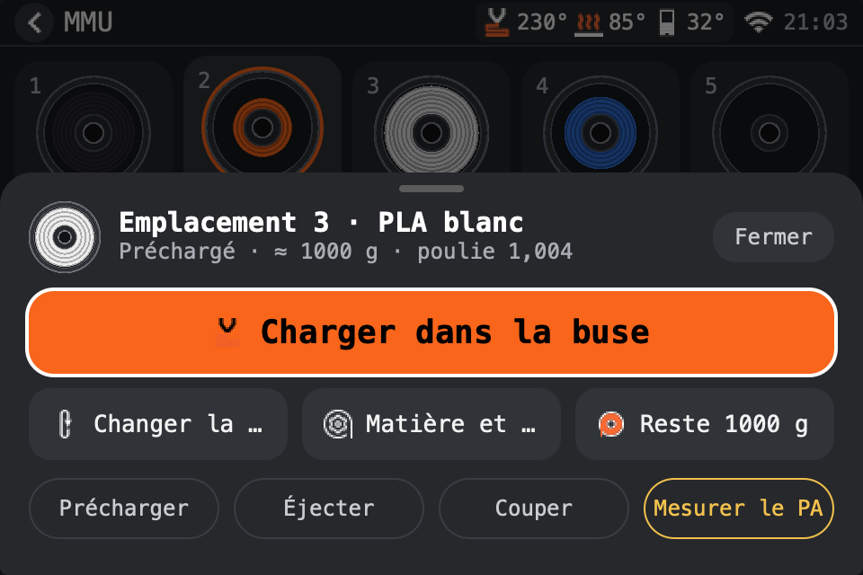
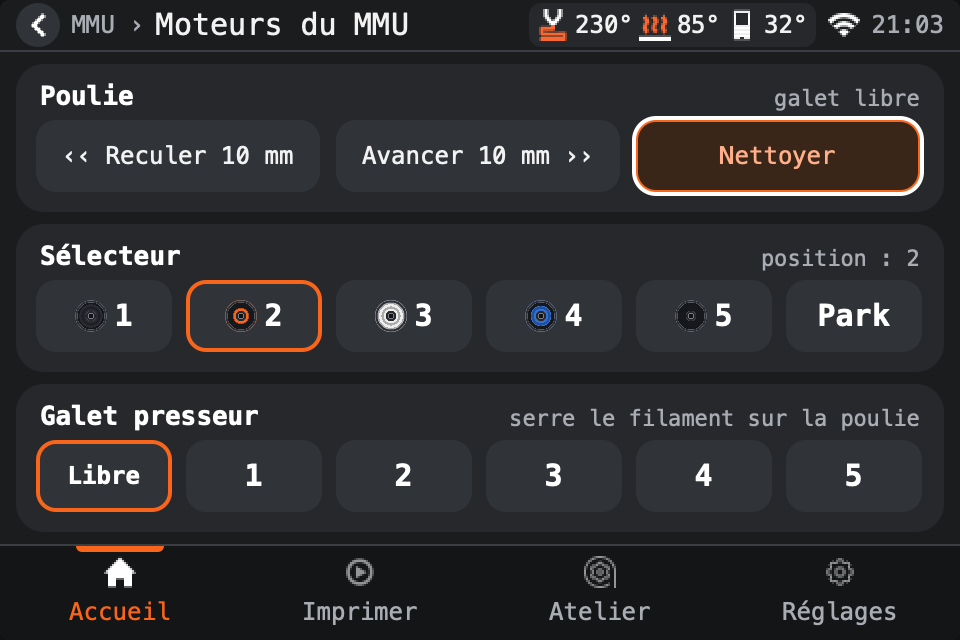
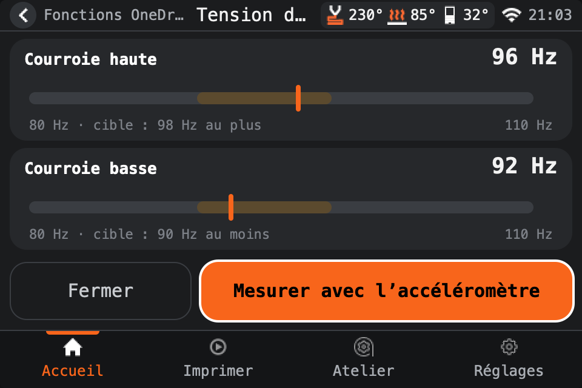
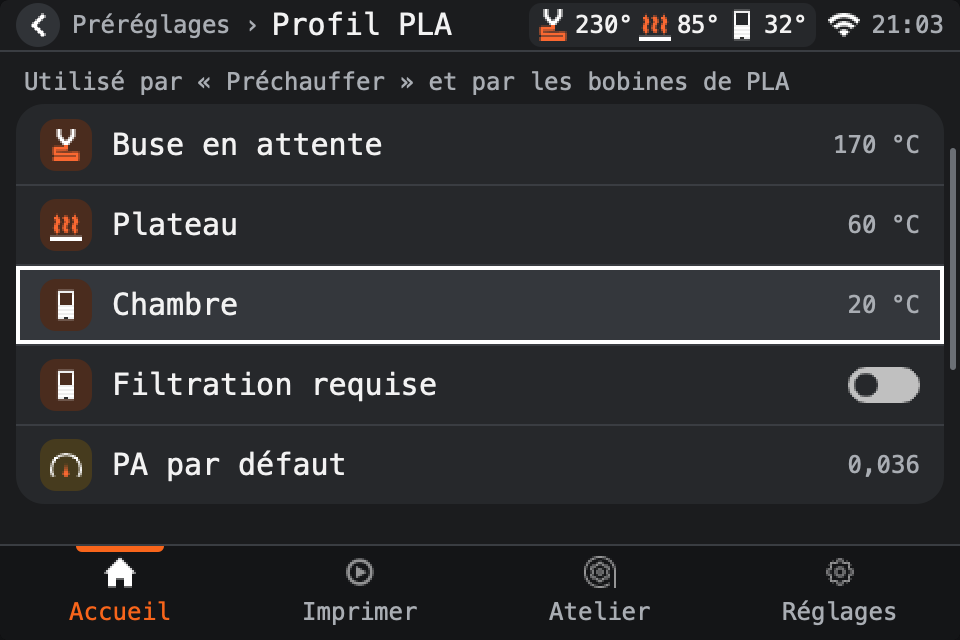
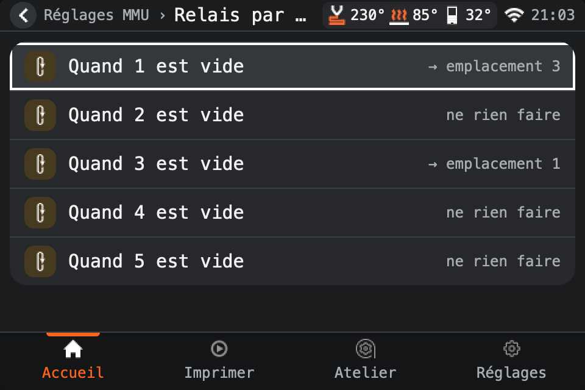
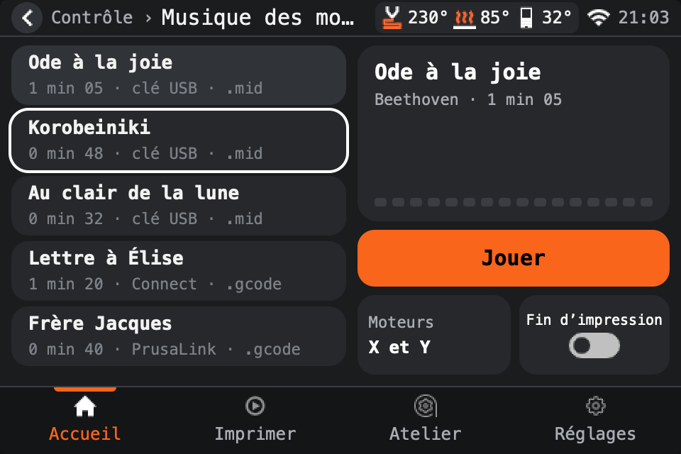
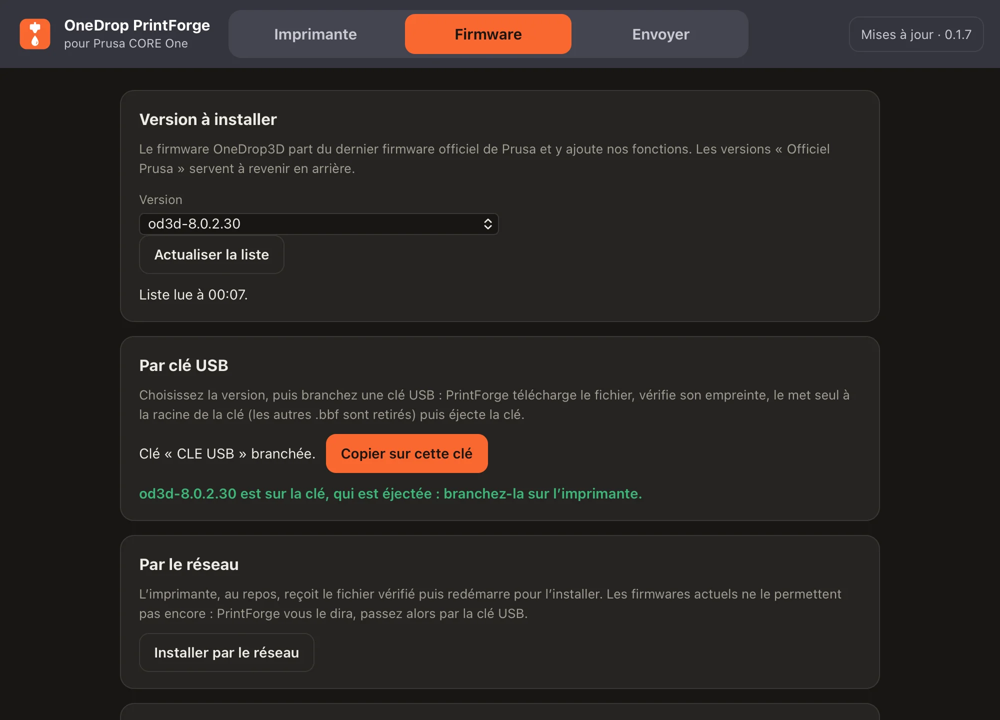

<p align="center">
  
</p>

<p align="center">
  <a href="README.md">Français</a> · <b>English</b>
</p>

<p align="center">
  <a href="https://github.com/OneDrop3D/Prusa-Firmware-Buddy/releases/latest"></a>
  
  
  
  
</p>

**OneDrop3D firmware** builds on Prusa's official 8.0.3 firmware for the CORE One family. It adds a new touch interface, an assistant that calibrates the machine in one click using the load cell, and much deeper control of the MMU3. Every release picks up Prusa's latest fixes. The interface is available in English and French.

> [!CAUTION]
> **Unofficial project, not affiliated with Prusa Research. You install it at your own risk.** Read the [disclaimer](#disclaimer) before installing.

## Compatibility

| Printer | Release file | Status |
|---|---|---|
| **CORE One**, One+ and One+ Gen2, **with MMU3** | `coreone_release_boot_8.0.3-OD3D.<n>.bbf` | the project's test machine |
| **CORE One without MMU3** | the same file | works; the MMU3 features simply stay unused |
| **CORE One L**, with or without MMU3 | `coreonel_release_boot_8.0.3_OD3D.<n>.bbf` | built and tested by CI for every release, not yet tried on a machine |
| **CORE One INDX** | `coreone_indx_release_boot_8.0.3_OD3D.<n>.bbf` | built and tested by CI for every release, not yet tried on a machine |
| **CORE One L INDX** | `coreonel_indx_release_boot_8.0.3_OD3D.<n>.bbf` | built and tested by CI for every release, not yet tried on a machine |
| MK4, MK3.5, MK3.9, XL, MINI | — | not supported |

- INDX versions have no MMU3: Prusa's tool changer takes its place.
- Accelerometer measurements (belts, input shaper…) need an accelerometer. A printer without one keeps every other feature.

## Screens

> These images come from the interface mock-up. Photos of the printer will replace them.

<table>
  <tr>
    <td width="50%"><br><b>Home</b> — MMU spools, last file, temperatures.</td>
    <td width="50%"><br><b>Print</b> — files on the USB drive with previews, time and colours.</td>
  </tr>
  <tr>
    <td><br><b>Spool card</b> — the whole MMU from a single card.</td>
    <td><br><b>MMU motors</b> — selector, idler and pulley by hand.</td>
  </tr>
  <tr>
    <td><br><b>Belts</b> — measured tension, advice in eighths of a turn.</td>
    <td><br><b>Presets</b> — Prusa's own, editable (chamber included).</td>
  </tr>
  <tr>
    <td><br><b>Spool join</b> — an empty spool hands over to the next one.</td>
    <td><br><b>Music</b> — the motors play a MIDI file from the USB drive.</td>
  </tr>
</table>

## What it adds

✅ = verified on the machine. Everything else is being tested: each [release](https://github.com/OneDrop3D/Prusa-Firmware-Buddy/releases) note says what to try.

**Interface**
- New touch interface with 4 tabs (Home, Print, Workshop, Settings), everything also reachable with the knob.
- All of Prusa's menus redrawn in the same style; swipe to go back.
- A badge follows the running process (print, load, measurement) while you browse elsewhere.
- Sleep mode: screen and light off, wake by touch, knob or a new print.

**One-click calibration**
- An assistant chains the tests and shows a before → after summary with figures.
- ✅ Pressure advance measured by the load cell on printed lines, once per spool.
- Maximum flow and minimum temperature per spool, MPC nozzle temperature control.
- Belt tension, critical speeds, damping, input shaper about 100 times faster (same result as Prusa).
- Nozzle expansion, fan response, filament acceleration, XY squareness.

**MMU3**
- Card per spool: load, preload, eject, cut, remaining weight.
- PTFE tube length measured automatically; pulley speed measured.
- Filament kept in the nozzle from one print to the next: no reload, and a short purge line when the next print uses the same one.
- Load error during a print: "Stop the print" so you can work on the MMU3.
- MMU3 update through the printer's front USB port, through its own USB port (✅ with PrusaSlicer) or from [PrintForge](https://github.com/OneDrop3D/PrintForge).

**Printing**
- Speed in 5 modes (Quiet, Normal, Fast, Very fast, Ultra fast) and manual setting up to 300 %.
- Object cancelling on a map of the bed.
- Enclosure temperature can be changed at any time, even while heating.
- Bed mesh reused when nothing has changed: faster start.
- Editable filament presets, with a way back to Prusa's value.
- Stop on a collision detected by the load cell.
- New releases installed over the network, from PrintForge.

## Install

**With OneDrop PrintForge (easiest).** The app picks the release, prepares the USB drive or sends the firmware over the network, and updates the MMU3 too.

<p align="center"></p>

**By hand**
1. In the [latest release](https://github.com/OneDrop3D/Prusa-Firmware-Buddy/releases/latest), download the file for your printer (see [Compatibility](#compatibility)).
2. Copy it **alone** to the root of a FAT32 USB drive (MBR partition scheme).
3. With the printer off, break the appendix of the xBuddy board if not done yet ([Prusa's article](https://help.prusa3d.com/article/zoiw36imrs-flashing-custom-firmware)).
4. Plug in the drive and switch on: the printer offers to install it.
5. Check in Settings › Info › Version: `8.0.3+<build>.OD3D.<n>`.

**Going back to the official firmware**: every release includes Prusa's official files for the CORE One and the CORE One INDX. For the CORE One L, get it from [Prusa's website](https://www.prusa3d.com/drivers/). Put it alone on the drive, press reset, then press the knob once as soon as the logo appears.

## Disclaimer

This firmware is an **unofficial** project, independent from Prusa Research, which neither endorses nor reviews it.

- It is provided **"as is", without any warranty**, as stated by the GNU GPL v3 license (sections 15 and 16): no warranty that it works, nor that it fits any particular purpose.
- **You install and use it at your own risk.** OneDrop3D and the project's contributors cannot be held liable for any damage, direct or indirect: to the printer, the MMU3, prints, property or people, nor for any loss of warranty.
- Installing it requires breaking the appendix of the xBuddy board. [Prusa's article](https://help.prusa3d.com/article/zoiw36imrs-flashing-custom-firmware) explains what this means, including for the warranty.
- The safety protections of Prusa's firmware (thermal runaway, minimum and maximum temperatures, nozzle fan monitoring…) are kept. They do not replace your attention: do not leave the printer running unattended.
- Going back to the official firmware is possible at any time (see [Install](#install)).

## Build

Same as Prusa's firmware (Python 3.8 or newer). The preset picks the printer: `coreone`, `coreonel`, `coreone_indx` or `coreonel_indx`.

```bash
python utils/build.py --preset coreone --build-type release --bootloader yes \
  --version-suffix=+0.OD3D --version-suffix-short=-OD3D+0 \
  -DDEVELOPMENT_ITEMS_ENABLED:BOOL=NO -DTRANSLATIONS_LIST:STRING=fr
```

Published releases are built and tested by GitHub Actions (`.github/workflows/od3d.yml`), which sets the real build number. Prusa's full guide, unchanged: [doc/](doc/) and [tests/unit/README.md](tests/unit/README.md).

## Credits and license

- [Prusa Research](https://github.com/prusa3d/Prusa-Firmware-Buddy) — the original firmware.
- [Marlin](https://marlinfw.org/) — the core of 3D printing.
- [Klipper](https://www.klipper3d.org/) — the input shaper code.

Source code under GNU GPL v3.0; graphics and design under CC BY-NC-SA 4.0; fonts have their own license (see [LICENSE](LICENSE.md)).
