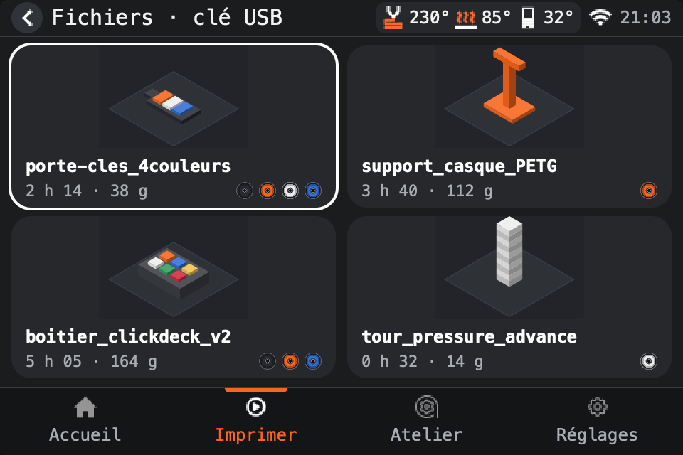
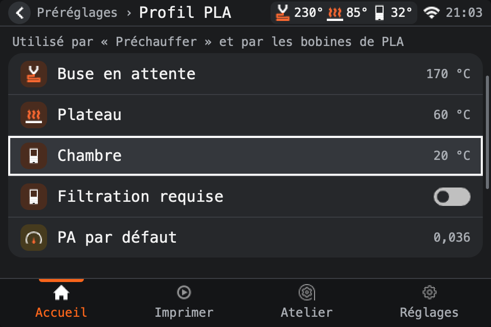

<p align="center">
  
</p>

<p align="center">
  <a href="https://github.com/OneDrop3D/Prusa-Firmware-Buddy/releases/latest"></a>
  
  
  
</p>

**Firmware OneDrop3D** part du firmware officiel 8.0.2 de Prusa et y ajoute une nouvelle interface tactile, un assistant qui calibre la machine en un clic par la cellule de charge, et plus de contrôle sur le MMU3. Chaque version reprend les dernières corrections de Prusa.

> [!WARNING]
> Projet **non officiel**, sans lien avec Prusa Research. Il faut casser l'appendice de la carte xBuddy pour l'installer ([article Prusa](https://help.prusa3d.com/article/zoiw36imrs-flashing-custom-firmware)). Le retour au firmware officiel reste possible à tout moment.

## Compatibilité

| Imprimante | État |
|---|---|
| **CORE One + MMU3** | la machine de test du projet |
| CORE One sans MMU | devrait fonctionner, sans les fonctions du MMU (pas testé) |
| MK4, MK3.5, MK3.9, XL | pas de fichier fourni : seule la CORE One est compilée |

## Les écrans

> Ces images viennent de la maquette de l'interface. Les captures de l'imprimante les remplaceront.

<table>
  <tr>
    <td width="50%"><br><b>Accueil</b> — les bobines du MMU, le dernier fichier, les températures.</td>
    <td width="50%"><br><b>Imprimer</b> — les fichiers de la clé avec leurs aperçus, durée et couleurs.</td>
  </tr>
  <tr>
    <td><br><b>Fiche de bobine</b> — tout le MMU depuis une seule fiche.</td>
    <td><br><b>Moteurs du MMU</b> — sélecteur, galet et poulie à la main.</td>
  </tr>
  <tr>
    <td><br><b>Courroies</b> — tension mesurée, conseil en huitièmes de tour.</td>
    <td><br><b>Préréglages</b> — ceux de Prusa, modifiables (chambre comprise).</td>
  </tr>
  <tr>
    <td><br><b>Relais de bobine</b> — une bobine vide passe la main à la suivante.</td>
    <td><br><b>Musique</b> — les moteurs jouent un fichier MIDI de la clé.</td>
  </tr>
</table>

## Ce qu'il ajoute

✅ = vérifié sur la machine. Le reste est en test : les notes de chaque [version](https://github.com/OneDrop3D/Prusa-Firmware-Buddy/releases) disent quoi essayer.

**Interface**
- Nouvelle interface tactile en 4 onglets (Accueil, Imprimer, Atelier, Réglages), tout atteignable aussi à la molette.
- Tous les menus de Prusa redessinés dans le même style ; retour en glissant.
- Pastille qui suit le processus en cours (impression, chargement, mesure) pendant qu'on navigue ailleurs.
- Mode veille : écran et lumière éteints, réveil au toucher, à la molette ou par une impression.

**Calibration en un clic**
- Assistant qui enchaîne les tests et affiche un bilan chiffré avant → après.
- ✅ Pressure advance mesuré par la cellule de charge sur des lignes imprimées, une fois par bobine.
- Débit maximal et température minimale par bobine, régulation MPC de la buse.
- Tension des courroies, vitesses critiques, amortissement, input shaper environ 100 fois plus rapide (même résultat que Prusa).
- Dilatation de la buse, réponse du ventilateur, accélération du filament, équerrage XY.

**MMU3**
- Fiche par bobine : charger, précharger, éjecter, couper, poids restant.
- Longueur du tube PTFE mesurée seule ; vitesse de la poulie mesurée.
- Filament chargé gardé en mémoire après un redémarrage : pas de purge inutile ; purge au débit mesuré.
- Mise à jour du MMU par son port USB (✅ avec PrusaSlicer) ou depuis [PrintForge](https://github.com/OneDrop3D/PrintForge).

**Impression**
- Maillage du plateau réutilisé quand rien n'a changé : départ plus rapide.
- Préréglages filament modifiables, avec retour à la valeur de Prusa.
- Arrêt sur collision détectée par la cellule de charge.
- Nouvelle version installée par le réseau, depuis PrintForge.

## Installer

**Avec OneDrop PrintForge (le plus simple).** L'application choisit la version, prépare la clé USB ou envoie le firmware par le réseau, et met aussi le MMU3 à jour.

<p align="center"></p>

**À la main**
1. Téléchargez `coreone_release_boot_8.0.2-OD3D.<n>.bbf` dans la [dernière version](https://github.com/OneDrop3D/Prusa-Firmware-Buddy/releases/latest).
2. Copiez-le **seul** à la racine d'une clé USB en FAT32 (schéma MBR).
3. Imprimante éteinte, cassez l'appendice de la carte xBuddy si ce n'est pas déjà fait ([article Prusa](https://help.prusa3d.com/article/zoiw36imrs-flashing-custom-firmware)).
4. Branchez la clé, allumez : l'imprimante propose l'installation.
5. Vérifiez dans Réglages › Info › Version : `8.0.2-OD3D.<n>`.

**Revenir au firmware officiel** : chaque version joint le `.bbf` officiel de Prusa. Mettez-le seul sur la clé, appuyez sur reset, puis une fois sur la molette dès que le logo apparaît.

## Compiler

Comme le firmware de Prusa (Python 3.8 ou plus récent) :

```bash
python utils/build.py --preset coreone --build-type release --bootloader yes \
  --version-suffix=-OD3D --version-suffix-short=-OD3D \
  -DDEVELOPMENT_ITEMS_ENABLED:BOOL=NO -DTRANSLATIONS_LIST:STRING=fr
```

Les versions sont compilées et testées par GitHub Actions (`.github/workflows/od3d.yml`). Le guide complet de Prusa, inchangé : [doc/](doc/) et [tests/unit/README.md](tests/unit/README.md).

## English

OneDrop3D firmware is an unofficial fork of Prusa firmware 8.0.2 for the **CORE One with MMU3**: a new touch interface, a one-click calibration assistant driven by the load cell (pressure advance from printed lines, max flow, belts, input shaper, nozzle expansion…), and deeper MMU3 control. The interface is in English and French. Grab the `.bbf` from the [releases](https://github.com/OneDrop3D/Prusa-Firmware-Buddy/releases) or use [OneDrop PrintForge](https://github.com/OneDrop3D/PrintForge).

## Crédits et licence

- [Prusa Research](https://github.com/prusa3d/Prusa-Firmware-Buddy) — le firmware d'origine.
- [Marlin](https://marlinfw.org/) — le cœur de l'impression 3D.
- [Klipper](https://www.klipper3d.org/) — le code de l'input shaper.

Code source sous GNU GPL v3.0 ; graphismes et design sous CC BY-NC-SA 4.0 ; les polices ont leur propre licence (voir [LICENSE](LICENSE.md)).
