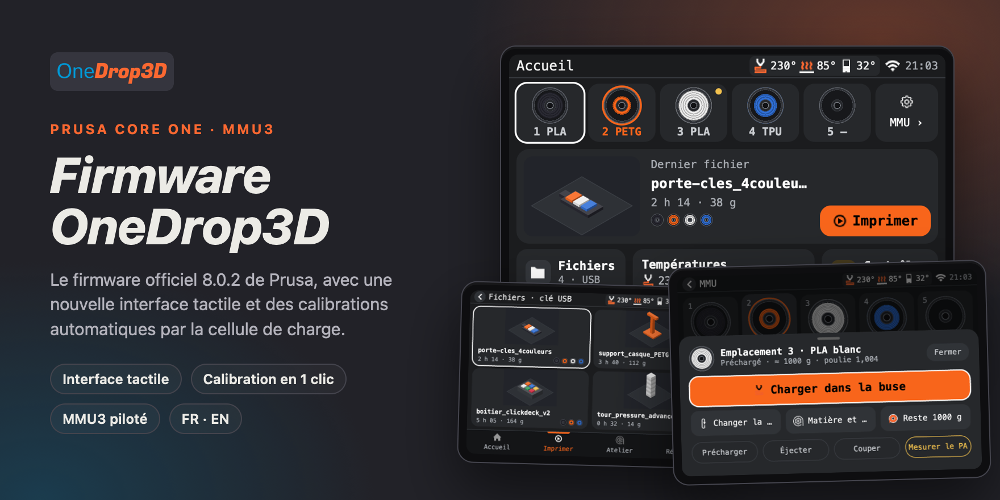
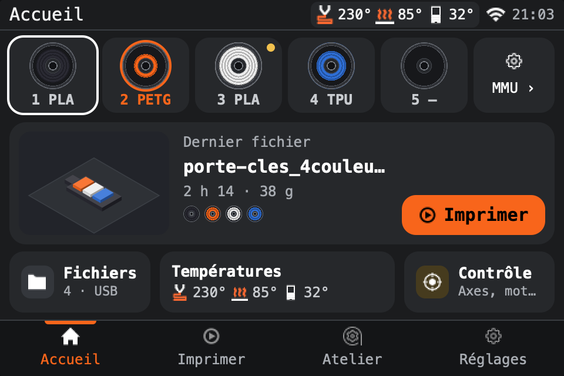
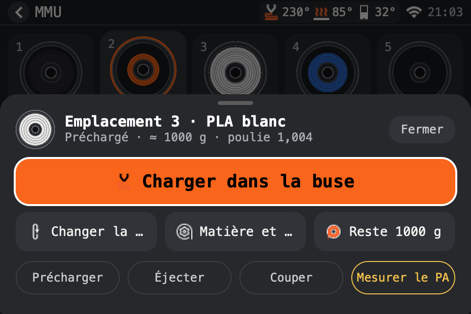
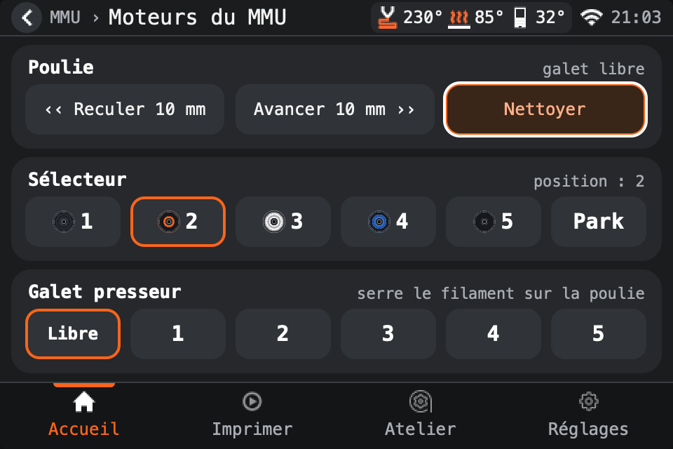
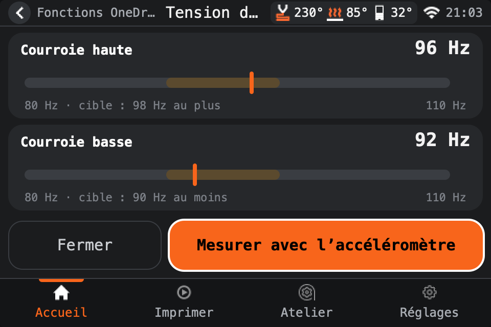
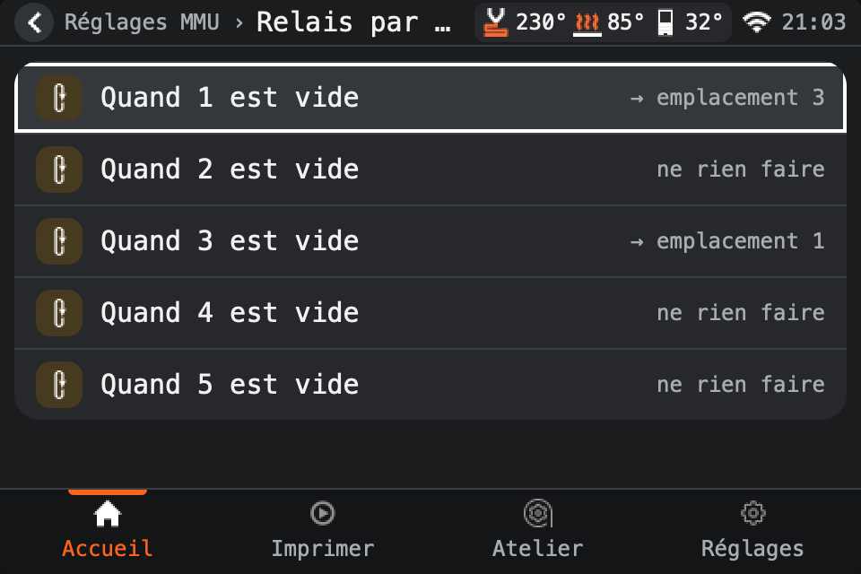
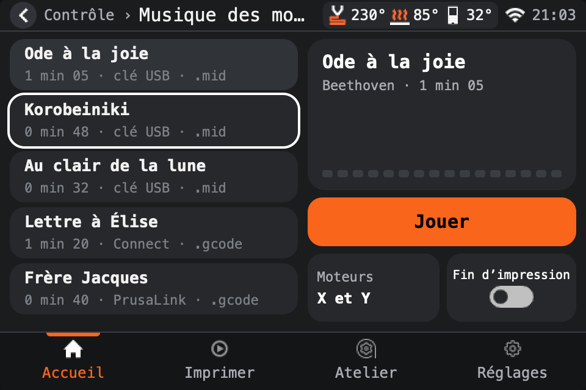
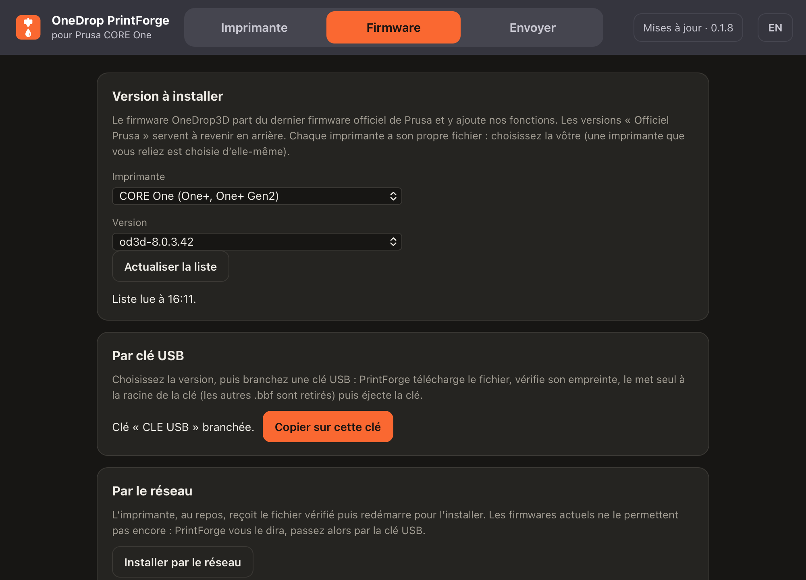

<p align="center">
  
</p>

<p align="center">
  <b>Français</b> · <a href="README.en.md">English</a>
</p>

<p align="center">
  <a href="https://github.com/OneDrop3D/Prusa-Firmware-Buddy/releases/latest"></a>
  
  
  
  
</p>

**Firmware OneDrop3D** part du firmware officiel 8.0.3 de Prusa pour la famille CORE One. Il ajoute une nouvelle interface tactile, un assistant qui calibre la machine en un clic grâce à la cellule de charge, et beaucoup plus de contrôle sur le MMU3. Chaque version reprend les dernières corrections de Prusa. L'interface existe en français et en anglais.

> [!CAUTION]
> **Projet non officiel, sans lien avec Prusa Research. Vous l'installez à vos propres risques.** Lisez l'[avertissement](#avertissement) avant d'installer.

## Compatibilité

| Imprimante | Fichier de la version | État |
|---|---|---|
| **CORE One**, One+ et One+ Gen2, **avec MMU3** | `coreone_release_boot_8.0.3-OD3D.<n>.bbf` | la machine de test du projet |
| **CORE One sans MMU3** | le même fichier | fonctionne ; les fonctions du MMU3 restent simplement inutilisées |
| **CORE One L**, avec ou sans MMU3 | `coreonel_release_boot_8.0.3_OD3D.<n>.bbf` | compilée et testée par la CI à chaque version, pas encore essayée sur une machine |
| **CORE One INDX** | `coreone_indx_release_boot_8.0.3_OD3D.<n>.bbf` | compilée et testée par la CI à chaque version, pas encore essayée sur une machine |
| **CORE One L INDX** | `coreonel_indx_release_boot_8.0.3_OD3D.<n>.bbf` | compilée et testée par la CI à chaque version, pas encore essayée sur une machine |
| MK4, MK3.5, MK3.9, XL, MINI | — | non prises en charge |

- Les versions INDX n'ont pas de MMU3 : le changeur d'outils de Prusa en tient lieu. Les mesures à l'accéléromètre y prennent une tête toutes seules, car l'accéléromètre est dans la tête. Les calibrations OneDrop3D à la cellule de charge (assistant, PA par bobine, débit maximal) et la détection de collision OneDrop3D sont faites pour le MMU3 : l'INDX garde celles de Prusa.
- Les mesures à l'accéléromètre (courroies, input shaper…) demandent un accéléromètre. Une imprimante qui n'en a pas garde toutes les autres fonctions.

## Les écrans

> Ces images viennent de la maquette de l'interface. Les captures de l'imprimante les remplaceront.

<table>
  <tr>
    <td width="50%"><br><b>Accueil</b> — les bobines du MMU, le dernier fichier, les températures.</td>
    <td width="50%"><br><b>Imprimer</b> — les fichiers de la clé avec leurs aperçus, durée et couleurs.</td>
  </tr>
  <tr>
    <td><br><b>Fiche de bobine</b> — tout le MMU depuis une seule fiche.</td>
    <td><br><b>Moteurs du MMU</b> — sélecteur, galet et poulie à la main.</td>
  </tr>
  <tr>
    <td><br><b>Courroies</b> — tension mesurée, conseil en huitièmes de tour.</td>
    <td><br><b>Préréglages</b> — ceux de Prusa, modifiables (chambre comprise).</td>
  </tr>
  <tr>
    <td><br><b>Relais de bobine</b> — une bobine vide passe la main à la suivante.</td>
    <td><br><b>Musique</b> — les moteurs jouent un fichier MIDI de la clé.</td>
  </tr>
</table>

## Ce qu'il ajoute

✅ = vérifié sur la machine. Le reste est en test : les notes de chaque [version](https://github.com/OneDrop3D/Prusa-Firmware-Buddy/releases) disent quoi essayer.

**Interface**
- Nouvelle interface tactile en 4 onglets (Accueil, Imprimer, Atelier, Réglages), tout aussi atteignable à la molette.
- Tous les menus de Prusa redessinés dans le même style ; retour en glissant.
- Pastille qui suit le processus en cours (impression, chargement, mesure) pendant qu'on navigue ailleurs.
- Mode veille : écran et lumière éteints, réveil au toucher, à la molette ou par une impression.

**Calibration en un clic**
- Assistant qui enchaîne les tests et affiche un bilan chiffré avant → après.
- ✅ Pressure advance mesuré par la cellule de charge sur des lignes imprimées, une fois par bobine.
- Débit maximal et température minimale par bobine, régulation MPC de la buse.
- Tension des courroies, vitesses critiques, amortissement, input shaper environ 100 fois plus rapide (même résultat que Prusa).
- Dilatation de la buse, réponse du ventilateur, accélération du filament, équerrage XY.

**MMU3**
- Fiche par bobine : charger, précharger, éjecter, couper, poids restant.
- Longueur du tube PTFE mesurée seule ; vitesse de la poulie mesurée.
- Filament gardé dans la buse d'une impression à l'autre : pas de rechargement, et une ligne de purge courte quand l'impression suivante demande le même.
- Erreur de chargement pendant une impression : « Arrêter l'impression » pour intervenir sur le MMU3.
- Mise à jour du MMU3 par le port USB avant de l'imprimante, par son propre port USB (✅ avec PrusaSlicer) ou depuis [PrintForge](https://github.com/OneDrop3D/PrintForge).

**Impression**
- Vitesse en 5 modes (Silencieux, Normal, Rapide, Très rapide, Ultra rapide) et réglage à la main jusqu'à 300 %.
- Annulation d'objets sur un plan du plateau.
- Température de l'enceinte modifiable à tout moment, même pendant la chauffe.
- Maillage du plateau réutilisé quand rien n'a changé : départ plus rapide.
- Préréglages filament modifiables, avec retour à la valeur de Prusa.
- Arrêt sur collision détectée par la cellule de charge.
- Nouvelle version installée par le réseau, depuis PrintForge.

## Installer

**Avec OneDrop PrintForge (le plus simple).** L'application choisit la version, prépare la clé USB ou envoie le firmware par le réseau, et met aussi le MMU3 à jour.

<p align="center"></p>

**À la main**
1. Dans la [dernière version](https://github.com/OneDrop3D/Prusa-Firmware-Buddy/releases/latest), téléchargez le fichier de votre imprimante (voir [Compatibilité](#compatibilité)).
2. Copiez-le **seul** à la racine d'une clé USB en FAT32 (schéma MBR).
3. Imprimante éteinte, cassez l'appendice de la carte xBuddy si ce n'est pas déjà fait ([article de Prusa](https://help.prusa3d.com/article/zoiw36imrs-flashing-custom-firmware)).
4. Branchez la clé et allumez : l'imprimante propose l'installation.
5. Vérifiez dans Réglages › Info › Version : `8.0.3+<build>.OD3D.<n>`.

**Revenir au firmware officiel** : chaque version joint les fichiers officiels de Prusa pour la CORE One et la CORE One INDX. Pour la CORE One L, prenez-le sur le [site de Prusa](https://www.prusa3d.com/drivers/). Mettez-le seul sur la clé, appuyez sur reset, puis une fois sur la molette dès que le logo apparaît.

## Avertissement

Ce firmware est un projet **non officiel**, indépendant de Prusa Research, qui ne le soutient ni ne le vérifie.

- Il est fourni **« tel quel », sans aucune garantie**, comme le prévoit la licence GNU GPL v3 (articles 15 et 16) : ni garantie de bon fonctionnement, ni garantie d'adéquation à un usage particulier.
- **Vous l'installez et l'utilisez à vos propres risques.** OneDrop3D et les contributeurs du projet ne pourront être tenus responsables d'aucun dommage, direct ou indirect : à l'imprimante, au MMU3, aux impressions, aux biens ou aux personnes, ni d'une éventuelle perte de garantie.
- L'installation demande de casser l'appendice de la carte xBuddy. L'[article de Prusa](https://help.prusa3d.com/article/zoiw36imrs-flashing-custom-firmware) explique ce que cela implique, notamment pour la garantie.
- Les protections de sécurité du firmware de Prusa (emballement thermique, températures minimales et maximales, surveillance des ventilateurs de la buse…) sont conservées. Elles ne remplacent pas votre vigilance : ne laissez pas l'imprimante fonctionner sans surveillance.
- Le retour au firmware officiel reste possible à tout moment (voir [Installer](#installer)).

## Compiler

Comme le firmware de Prusa (Python 3.8 ou plus récent). Le préréglage choisit l'imprimante : `coreone`, `coreonel`, `coreone_indx` ou `coreonel_indx`.

```bash
python utils/build.py --preset coreone --build-type release --bootloader yes \
  --version-suffix=+0.OD3D --version-suffix-short=-OD3D+0 \
  -DDEVELOPMENT_ITEMS_ENABLED:BOOL=NO -DTRANSLATIONS_LIST:STRING=fr
```

Les versions publiées sont compilées et testées par GitHub Actions (`.github/workflows/od3d.yml`), qui met le vrai numéro de build. Le guide complet de Prusa, inchangé : [doc/](doc/) et [tests/unit/README.md](tests/unit/README.md).

## Crédits et licence

- [Prusa Research](https://github.com/prusa3d/Prusa-Firmware-Buddy) — le firmware d'origine.
- [Marlin](https://marlinfw.org/) — le cœur de l'impression 3D.
- [Klipper](https://www.klipper3d.org/) — le code de l'input shaper.

Code source sous GNU GPL v3.0 ; graphismes et design sous CC BY-NC-SA 4.0 ; les polices ont leur propre licence (voir [LICENSE](LICENSE.md)).
